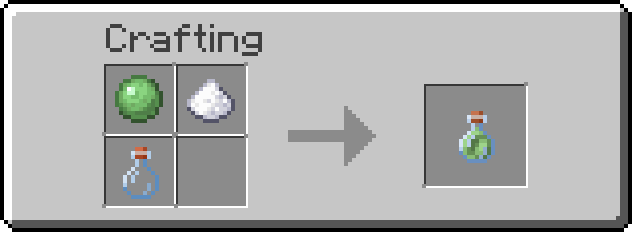
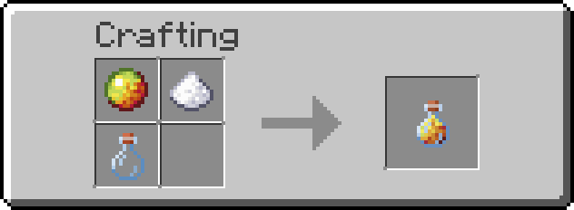
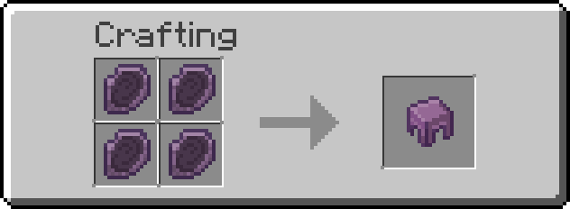

# Dangerous Dinner
*You can finally eat monsters!*
> BIG NOTE! This was originally made as a proof of concept for my friends. Textures and recipes are subject to change. (The mod is currently still in beta anyway.)

## New Foods
*Dangerous Dinner* adds 11 new types of food!
- **Zombie Steaks** from Zombies, Husks, and Drowneds
- **Spider Chop** from Spiders and Cave Spiders
- **Spice Cookie** from Blazes
- **Dynamite Cake** from Creepers
- **Guardian Filets** from Guardians and Elder Guardians
- **Ghastly Takoyaki** from Ghasts
- **Jelly** from Slimes and Magma Cubes
- **Shulker Oyster** from Shulkers
- **Pillager Drumsticks** from Pillagers, Evokers, and Vindicators
- **Ravager Brisket** from Ravagers
- **Warden Ribs** from the Warden

## How to Make
First of all, you may be pondering the reasons behind this mod. I thought that killing monsters should be more fulfilling. Some monsters (such as Pillagers) rarely drop anything. This is bad, because Pillagers are annoying. Therefore, I now gain a reward for slaughtering them 😊

Some monsters drop raw meat directly, while others can be used in crafting recipes. Furthermore, some foods have special effects!

### Just cook them:
These items can be cooked in a furnace, smoker, or campfire.
- **Zombie Steak** ← Raw Zombie Beef. *Zombie Beef is dropped upon killing Zombies, Zombie Villagers, or Zombie Horses.*
- **Husk Steak** ← Raw Husk Beef. *Husk Beef is dropped upon killing Husks.*
- **Cooked Spider Chop** ← Raw Spider Chop. *Spider Chops are dropped upon killing Spiders or Cave Spiders.*
- **Sautéed (Elder) Guardian Filet** ← Raw (Elder) Guardian Filet. *Guardian Filets are dropped by Guardians, with a rarer Elder Guardian Filet dropped by Elder Guardians upon death.*
- **Pillager Drumsticks** ← Raw Pillager Meat. *Pillager meat drops from Pillagers, Evokers, and Vindicators upon death.*
- **Ravager Brisket** ← Raw Ravager Meat. *Ravager meat drops from Ravagers upon death.*
- **Roasted Shulker Oyster** ← Shulker Oyster. *Shulker oyster can be eaten raw with the same nutritional value, but cooking it gives a slow fall status effect. They are dropped from shulkers.*
- **Sautéed Warden Ribs** ← Warden Ribs. *Miniboss food: high saturation. Drops from the Warden upon death.* 

### Craftable:
These items have crafting recipes.
- **Dynamite Cake** ← Substitute *gunpowder* for *sugar* in your cake recipe.

- **Spice Cookies** ← Substitute *blaze powder* for *wheat* in your cookie recipe.

- **Jelly** ← Craft *slime balls* or *magma cream* with *sugar*. *Magma jelly* gives you a *fire resistance* effect for a few seconds.
  
  
- **Ghastly Takoyaki** ← Craft *ghast tentacle* with *wheat* and *egg*.

### Other things:
- Shulker oyster shells can be composted. You can also craft 4 of them together to make a shulker shell.
  

LIST IS NOT COMPLETE. MORE RECIPES ARE COMING SOON.

---
this is my first Fabric mod. please be nice